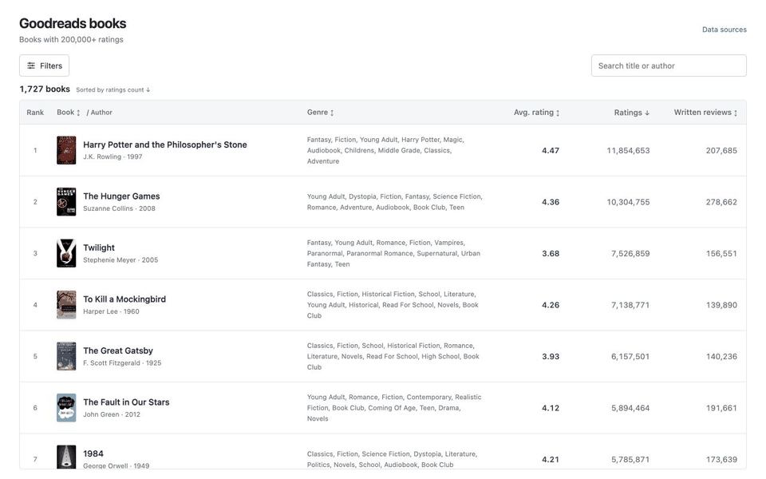
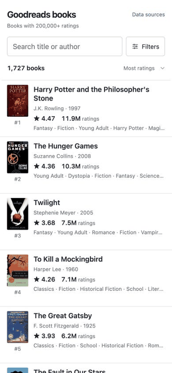

# Goodreads explorer

Vibe-coded static site for filtering, searching, and sorting Goodreads books with 200k+ ratings (1,727 books as of 10/6/2026). Built primarily out of frustration with the existing Goodreads explore functionality. Also a fun design exercise. 

## Desktop

[Watch the desktop video](https://github.com/jeremy-washam/goodreads-explorer/raw/refs/heads/main/docs/media/goodreads-desktop.mp4)

## Mobile

[Watch the mobile video](https://github.com/jeremy-washam/goodreads-explorer/raw/refs/heads/main/docs/media/goodreads-mobile.mp4)
